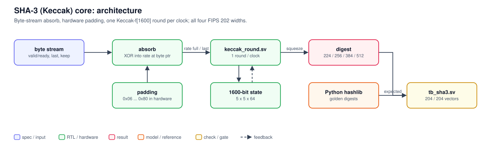
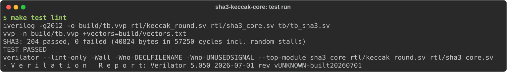

# SHA-3 (Keccak) hash core

[](https://github.com/Ana2601/sha3-keccak-core/actions/workflows/ci.yml)

Hardware SHA-3 core implementing FIPS 202 SHA3-224/256/384/512, selectable per message, with byte-stream input and hardware multi-rate padding.

## Architecture



- `rtl/keccak_round.sv`: one full round (θ, ρ, π, χ, ι), purely combinational, generated lane by lane.
- `rtl/sha3_core.sv`: absorb / pad / permute FSM, 24 clocks per block, mode sampled on the first byte.
- Empty messages and messages ending exactly on a block boundary are handled (`in_keep=0` on the last beat).

## Verification

- Golden model: Python `hashlib.sha3_*`.
- 204 vectors: every block-boundary length (0, 1, rate−1, rate, rate+1, 2·rate±1 …) for all four modes, 160 random lengths, and the NIST `"abc"` known-answer vectors.
- Random input stalls on every byte exercise the valid/ready handshake.

## Results (measured)

| Check | Result |
|---|---|
| Vectors | **204 / 204 pass** (all 4 modes) |
| Lint | Verilator `-Wall` clean |

## Run

```bash
make test      # generate vectors + simulate (Icarus)
make lint
make synth     # Yosys generic synthesis, cell report in build/
```

## Test run

Output of the CI command (`make test lint`), captured from a local run:



## Limitations / next steps

Byte-wide input: absorbing one byte per clock makes input bandwidth, not the permutation, the throughput limit. A 64-bit lane-wide input would absorb a block in 17–18 clocks. SHAKE XOFs are not implemented.

## Setup

- [OSS CAD Suite](https://github.com/YosysHQ/oss-cad-suite-build) (Icarus Verilog, Verilator, Yosys)

```bash
make test
make lint
```

The same commands run in CI on every push (`.github/workflows/ci.yml`).
